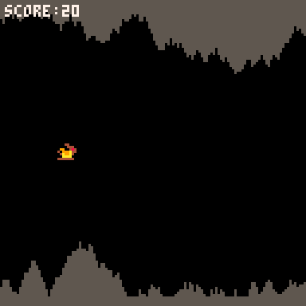
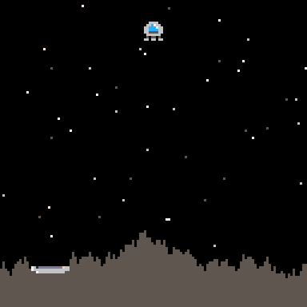
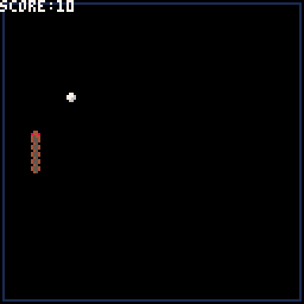
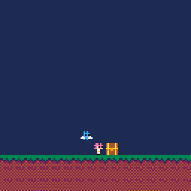

<h1 align="center">PICO-8 Mini Games</h1>

<h3 align="center">A collection of mini games I developed using PICO-8, exported into html and bundled into a website.</h3>

  
  
  

<table align="center">
  <tr>
    <td align="center">
       
      <em>Dragon Hop</em>
    </td>
    <td align="center">
       
      <em>Lander</em>
    </td>
  </tr>
  <tr>
    <td align="center">
       
      <em>Simple Snakes</em>
    </td>
    <td align="center">
       
      <em>The Dragon & The Exceed</em>
    </td>
  </tr>
</table>
